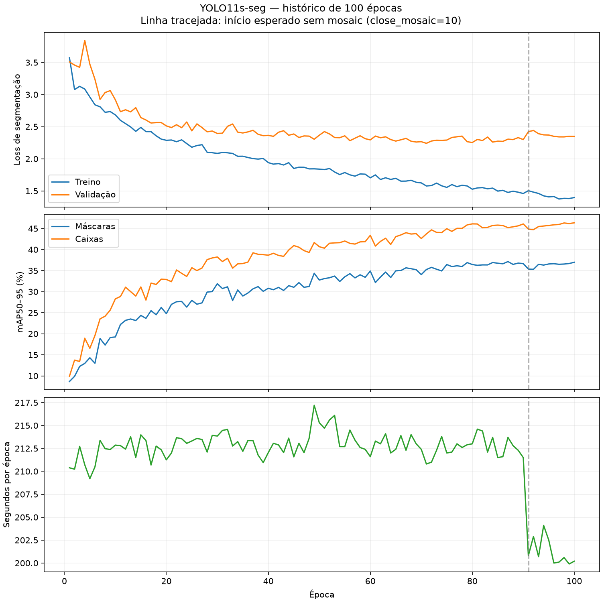

# Diagnóstico de treinamento — 02/11/2026

Situação atual: o fine-tuning com cinco recortes CEU Paz foi concluído em GPU, com seis épocas e early stopping.
Gargalo atual: confirmar generalização em outros voos e avaliar a regressão em vegetação.
Recomendação: comparar o novo candidato com os pesos anteriores, preservados como padrão do projeto.
Tempo medido: 63,49 s incluindo setup e avaliação final do treino; a avaliação semântica foi feita separadamente.
Resultado: mIoU nas dez fotos próprias passou de 51,76% para 58,93%, com perda de 0,26 p.p. no teste antigo.

O restante deste documento registra o diagnóstico e as estimativas iniciais.
A execução e os resultados atuais estão no [relatório do fine-tuning](finetuning_ceu_paz_5.md).

Prazo confirmado pelo usuário: **04/11/2026, 23h59, America/Sao_Paulo, incluindo avaliação**.
Às 02h05 de 02/11, restavam aproximadamente 69h53. Só esta máquina está disponível.
O usuário não sabe onde estão os rótulos antigos. Implementação e treinamento dependem de aprovação posterior.

Decisão atual do usuário, posterior ao plano inicial de concluir os 12 recortes:
**usar somente os cinco primeiros recortes CEU Paz, declarados completamente
rotulados, e excluir os sete restantes**. O dataset separado contém 280 imagens
antigas e cinco novas no treino, preservando as 80 de validação e 40 de teste.
O novo preparo, o teste curto, o fine-tuning e a comparação final foram concluídos
conforme essa orientação. Os detalhes atualizados ficam em `finetuning_ceu_paz_5.md`.

Atualização após a instalação do driver pelo usuário, em 02/11: a RTX 4050 está
usando o módulo NVIDIA Open 595.112.07. Uma verificação fora do ambiente isolado
confirmou `nvidia-smi` funcional, 6141 MiB de VRAM, PyTorch 2.14.1+cu130 com
`torch.cuda.is_available() == True` e uma multiplicação de matrizes em CUDA com
resultado esperado (32,0). A falha de acesso ainda observada dentro do isolamento
não se reproduziu no sistema. A migração para CUDA 12.4 proposta inicialmente
fica dispensada por enquanto. Isso valida um cálculo simples, não a velocidade
do treino nem a aceleração do ambiente próprio do X-AnyLabeling. As medições
originais em JSON e as observações históricas abaixo foram preservadas.

## Evidências e escopo

Foram inspecionados `src/train.py`, `src/config.py`, `src/preparar_dataset.py`,
`src/evaluate.py`, `dataset.yaml`, configurações e CSVs em `runs/`, metadados dos
pesos principais, estrutura do dataset, anotações novas e o índice do ZIP original.
Também foram consultadas fontes oficiais na internet, vinculadas abaixo.

Na auditoria inicial, foi realizada uma nova avaliação em CPU das dez fotos próprias. Nenhum treino,
instalação, troca de driver, extração do ZIP ou alteração dos dados originais foi
executado. Os 31 hashes registrados na avaliação anterior foram conferidos antes
e depois: todos permaneceram iguais. `best.pt` e `last.pt` principais têm o mesmo
SHA-256: `5273d0c771806307aabace260495866f5d088859851abf0a4a7490b3fde16ff1`.

Os [resultados da auditoria](diagnostico_treinamento_2026-11-02.json) registram
tempos, métricas, contagens, hashes e valores do CSV. As curvas abaixo foram
geradas diretamente desse CSV, sem suavização.



## 1. Setup identificado

| Item | Evidência local |
| --- | --- |
| Tarefa | Segmentação de instâncias em fotos de drone: construção, vegetação e via |
| Modelo | YOLO11s-seg ajustado para três classes; 10.083.449 parâmetros no checkpoint |
| Framework | Python 3.13, Ultralytics 8.4.190, PyTorch 2.14.1+cu130, torchvision 0.29.1 |
| Dados antigos | 280 imagens de treino, 80 de validação e 40 de teste; JPEG, 1024 × 682; 132.585.311 bytes no total |
| Rótulos antigos | Faltam os 400 TXT nas pastas `dataset/labels/train`, `val` e `test` |
| Dados próprios de avaliação | 10 fotos de 4032 × 2268; 176 polígonos válidos exportados em `dataset/labels/images` |
| Novos dados | 12 recortes CEU Paz de 1536 × 1536; três JSON presentes, totalizando 62 formas; nenhum TXT exportado na pasta prevista |
| CPU e RAM | Intel Core i5-13420H, 12 CPUs lógicas; aproximadamente 15 GiB RAM, 8,1 GiB disponíveis na leitura; sem swap |
| GPU | `/proc/driver/nvidia/gpus/.../information` identifica RTX 4050 Laptop; VRAM não foi medida |
| Armazenamento | Volume local NVMe, aproximadamente 167 GiB livres na leitura |
| Recursos de treino | Batch 8, resolução 640, workers 2, `nbs=64`, AMP solicitado, cache desativado, validação por época, patience 20 |

Não há DeepSpeed, FSDP, Accelerate ou adapters no script. A execução usa o trainer
do Ultralytics. Os requisitos não fixam versões; uma instalação futura pode mudar
o ambiente.

O módulo do driver é **550.163.01**, enquanto o PyTorch foi compilado para
**CUDA 13.0**. `torch.cuda.is_available()` retornou `False`, com mensagem explícita
de driver antigo; `nvidia-smi` também falhou. A NVIDIA exige driver da família
580 ou superior para CUDA 13.x. Além disso, a visibilidade dos dispositivos no
ambiente de execução precisa ser validada; trocar os pacotes não garante resolver
todo o acesso à GPU. [Compatibilidade NVIDIA](https://docs.nvidia.com/deploy/cuda-compatibility/minor-version-compatibility.html).

Uma opção reversível para o teste de compatibilidade é criar outro ambiente com
`torch==2.6.0`/`torchvision==0.21.0` CUDA 12.4, preservando a `.venv` atual e o
Ultralytics 8.4.190. Há wheels Linux x86-64 para Python 3.13. É um candidato a
validar com importação, kernels CUDA e inferência antes do treino, sem garantia
prévia de compatibilidade de toda a aplicação.
[Combinações oficiais](https://pytorch.org/get-started/previous-versions/),
[wheel torch](https://download.pytorch.org/whl/cu124/torch/),
[wheel torchvision](https://download.pytorch.org/whl/cu124/torchvision/).

## 2. Velocidade, conclusão e convergência

O CSV principal tem exatamente 100 épocas completas e tempo cumulativo de
21.165,5 segundos: **5h52min45,5s**. Média de **211,655 s/época**; mediana de
212,7 s; últimas dez épocas com média de 201,18 s. O intervalo observado foi
199,9–217,2 s/época. Os dois testes rápidos completos duraram 174,121 e 184,105 s,
com três épocas e fração de treino de 20%. Eles não medem a convergência final.

Usando as 280 imagens atualmente presentes como referência do conjunto histórico:

- 35 minibatches por época (`ceil(280 / 8)`);
- **1,323 imagens/s efetivas** (`280 / 211,655`);
- **0,165 minibatches/s efetivos** (`35 / 211,655`).

Essas taxas incluem o tempo de validação e demais operações registradas entre
épocas. Não equivalem ao throughput isolado de forward/backward. O número exato
de atualizações do otimizador/s não foi registrado: com `nbs=64` e batch 8, a
acumulação nominal é oito minibatches, com ajuste durante warmup. Falta um
manifesto histórico para provar que os 280 arquivos atuais são exatamente os
mesmos usados em outubro.

**Tempo restante do treino antigo: zero.** Os pesos datam de 27/10. Ambos têm
`epoch=-1` e `optimizer=None`, compatíveis com checkpoints finalizados pelo
Ultralytics. Para novos dados, iniciar outro fine-tuning carregando os pesos;
`resume=True` não restaura o estado de otimização desse treino finalizado.

Não existe medição de velocidade de treinamento no ambiente atual. O histórico
não registra a GPU usada nem comprova que AMP efetivamente ficou habilitado.
Assim, 5h53 é referência histórica, não uma previsão validada para a instalação
atual com CUDA indisponível.

| Época | Loss segmentação treino | Loss segmentação validação | mAP50–95 máscaras | mAP50–95 caixas |
| --- | ---: | ---: | ---: | ---: |
| 1 | 3,574 | 3,508 | 8,666% | 9,921% |
| 20 | 2,289 | 2,513 | 24,781% | 32,891% |
| 50 | 1,840 | 2,368 | 32,758% | 40,679% |
| 60 | 1,704 | 2,295 | 34,898% | 43,381% |
| 80 | 1,527 | 2,254 | 36,448% | 46,099% |
| 87 | — | — | **37,149%** | — |
| 100 | 1,397 | 2,350 | 36,979% | **46,349%** |

As métricas convergem, com retornos menores no final. A menor loss de validação
de segmentação foi 2,24149 na época 71. A loss de treino continua caindo enquanto
a validação oscila e termina acima do mínimo: indício de sobreajuste moderado nas
máscaras. Não há NaN/Inf no CSV nem evidência de colapso do treino principal.
Não é possível concluir underfitting apenas com esses valores.

O melhor mAP das máscaras ocorreu na época 87; o melhor critério conjunto ocorreu
na época 100. Nesta versão instalada, a fitness de segmentação soma mAP50–95 de
caixas e máscaras; isso explica a escolha do checkpoint final. Não significa que
`best.pt` maximize isoladamente a qualidade das máscaras.

Parar na época 80 teria poupado 4.140 s (1h09min) nesse histórico, mas o mAP das
máscaras naquela época era 0,531 ponto percentual menor que no final. Não é uma
previsão de uma nova execução de 80 épocas: mudar a duração também muda o schedule
e a posição do fechamento de mosaic. O ganho tardio é pequeno, mas não nulo.

### Reavaliação medida em 02/11

| Classe | IoU | Dice |
| --- | ---: | ---: |
| Construção | 52,56% | 68,90% |
| Vegetação | 64,15% | 78,16% |
| Via | 38,60% | 55,70% |
| Média | **51,77%** | **67,59%** |

Configuração: CPU, duas threads, imagens processadas individualmente, `imgsz=640`,
`conf=0.25`, máscaras na resolução original, funções existentes de `src.evaluate`.
Inicialização e uma inferência de aquecimento: **1,977 s**. As dez imagens e o
cálculo das métricas: **9,687 s**, aproximadamente **1,032 imagens/s** incluindo
leitura e métricas. Isso é velocidade de avaliação, não de treinamento.

As médias diferem da avaliação de 29/10 por menos de 1,4 × 10⁻⁸ em escala 0–1.
As dez imagens são do mesmo voo e foram escolhidas para diagnóstico. Não há
garantia de generalização para outros voos, e mAP não é diretamente comparável
com o mIoU semântico usado nesta avaliação.

## 3. Gargalos e desperdícios

| Aspecto | Resultado e implicação |
| --- | --- |
| GPU | CUDA indisponível agora. Não foi possível medir utilização, VRAM, potência ou espera por dados. Corrigir e medir antes de atribuir o gargalo histórico à GPU ou ao loader. |
| Dataloader | `workers=2` na configuração, `cache=False`. O código instalado força workers zero em CPU. Em GPU, comparar 2 e 4 com a mesma amostra; pinned memory já é habilitada pelo builder quando há acelerador. |
| Pré-processamento | Imagens já reduzidas a 1024 × 682; treino faz resize/letterbox, mosaic, transformações e rasterização das máscaras. O tempo individual dessas operações não foi registrado. |
| Batch/acumulação | Batch 8, acumulação nominal 8, batch efetivo nominal 64. Testar batch maior apenas depois de medir a VRAM; alterar acumulação não elimina os forward/backward dos exemplos. |
| Precisão | AMP solicitado em `args.yaml`; FP16 dos pesos salvos não prova a precisão usada no treino. O trainer pode desativar AMP após a checagem. Manter AMP se passar o smoke test em CUDA. |
| I/O | Volume NVMe local e conjunto comprimido pequeno (~126,44 MiB). Nenhum acesso de rede aparece no caminho dos dados de treino; não há perfil histórico de disco ou espera de I/O. Não foi medido bandwidth sustentado. |
| Cache | Um cache RGB de imagens 640 × 426 para os 360 exemplos de treino/validação ocuparia aproximadamente 281 MiB antes de overhead. Cabe no orçamento de RAM observado, mas o ganho precisa de comparação. |
| Checkpoints | `save=True`, `save_period=-1`: sem arquivos periódicos extras, mas last é salvo por época e best quando melhora. Cada arquivo final tem ~20,5 MB; custo histórico não foi cronometrado. |
| Validação | Ocorre em cada época em 80 exemplos. É útil para seleção e early stopping; sem medição separada, não há base para prometer ganho removendo avaliações. |
| Padding | Imagens antigas têm proporção 1024:682; um letterbox quadrado 640 conteria cerca de 33,4% de padding vertical. É cálculo geométrico; mosaic/escala mudam isso no treino. `rect=True` muda também a amostragem/augmentações: testar antes de adotar. |
| Duplicação | SHA-256 não encontrou duplicatas binárias entre as 422 imagens das cinco pastas. Isso não detecta cenas vizinhas ou quase duplicatas. CEU Paz tem sobreposição espacial documentada. |
| Épocas | Retornos menores após ~60–80 épocas. Não há justificativa para reiniciar 100 épocas para incorporar poucos exemplos. |
| Integridade | Faltam rótulos para os 400 exemplos antigos. `carregar_ground_truth` retorna máscara vazia para TXT ausente; executar a avaliação padrão agora produziria referência incorreta. |

A documentação do [PyTorch sobre carregamento](https://docs.pytorch.org/tutorials/recipes/recipes/tuning_guide.html)
orienta ajustar workers e usar memória pinned em GPU. Os comportamentos efetivos
de workers, pinning e acumulação acima também foram conferidos no código local
instalado de `ultralytics/engine/trainer.py` e `ultralytics/data/build.py`.

## 4. Comparação das opções

Os ganhos quantitativos abaixo são contas sobre o CSV, e não benchmarks de um
novo treino. Onde faltam medições, o ganho aparece explicitamente como não medido.
Os esforços são avaliações qualitativas de implementação neste repositório.

| Ferramenta/técnica | Ganho estimado de velocidade | Impacto na qualidade | Esforço | Risco | Compatível? |
| --- | --- | --- | --- | --- | --- |
| Fine-tuning de `best.pt`, 20 épocas | ~4,7× menos tempo de treino que reiniciar 100 épocas, pela projeção de lotes com 12 recortes novos | Incorpora dados novos; ganho real depende da revisão; pode esquecer dados antigos | Baixo, após recuperar ambiente/dados | Médio | Sim, nativo |
| Ambiente separado CUDA 12.4 | Restaura possibilidade de usar GPU; fator GPU/CPU não medido | Espera-se equivalência aproximada, validar | Médio | Médio | Candidato compatível com driver; testar acesso/kernels |
| AMP FP16 / BF16 | FP16 já solicitado; ganho incremental não demonstrado. BF16 não medido | Checar losses e métricas | Baixo | Baixo/médio | FP16 nativo; BF16 depende do runtime/GPU |
| Cache RAM + workers 2/4 | Não medido; útil se houver espera por dados | Cache não muda rótulos; reprodutibilidade pode variar | Baixo | Baixo | Sim; pinned memory já automática em GPU |
| Batch maior mantendo `nbs=64` | Não medido; limitado pela VRAM disponível | Pode mudar BatchNorm, ordem e dinâmica de treino | Baixo | Médio | Sim; VRAM ainda desconhecida |
| Early stopping / teto de 20–30 épocas | Custo aproximadamente proporcional às épocas; parada antecipada não garantida | Pode interromper ganho tardio | Baixo | Médio | Sim |
| Congelar primeiros dez blocos (`freeze=10`) | Não medido; reduz backward de parte do modelo | Menor adaptação do backbone; pode ajudar em dataset pequeno | Baixo | Médio | Sim; conferir blocos reais |
| `torch.compile` | Não medido; compilação pode não amortizar em treino curto | Exige comparar comportamento numérico | Baixo/médio | Médio | API disponível; backend depende do ambiente |
| `rect=True` / menor resolução | Padding teórico de ~33,4% nas imagens antigas; não equivale a esse ganho em tempo | Pode mudar augmentações ou perder detalhes de telhados/vias | Baixo | Médio | Sim |
| YOLO11n-seg | Treino não medido neste hardware | Menor capacidade; reinicia a transferência para outra arquitetura | Baixo/médio | Médio | Sim, mas pesos do modelo s não migram integralmente |
| Warmup + cosine / one-cycle | Não acelera o step por si só; eventual redução de épocas não medida | Alteração da otimização pode ajudar ou piorar | Baixo/médio | Médio | Cosine nativo; one-cycle exigiria adaptação |
| Gradient checkpointing | Troca memória por recomputação; sem ganho de tempo demonstrado | Em geral preserva objetivo, validar implementação | Médio/alto | Médio | PyTorch permite; não é uma opção direta do script |
| Quantização de treino / QLoRA | Não medido; não há integração pronta neste pipeline | Risco nas máscaras e no suporte dos kernels | Alto | Alto | Não diretamente |
| LoRA/adapters | Não medido; exige integração para YOLO | Adaptação potencialmente limitada | Alto | Alto | PEFT aceita Conv2d, mas o trainer atual não integra adapters |
| DeepSpeed/FSDP | Sem ganho demonstrado para este modelo de ~10 M parâmetros em uma GPU | Exige validar migração | Alto | Alto | Não integrado; sharding não resolve o problema atual |
| DDP / outra GPU | Não medido; só uma GPU local identificada | Validar batch global e equivalência | Médio/alto | Médio | Requer hardware adicional não disponível hoje |
| Lightning | Trocar o trainer não demonstra aceleração | Revalidar losses, validação e checkpoints | Alto | Alto | Possível com migração, desnecessária para o prazo |
| Unsloth / Axolotl / vLLM / FlashAttention | Sem ganho aplicável demonstrado neste trainer YOLO | Migração não justificada | Alto ou inaplicável | Alto | Não são substitutos diretos do pipeline atual |

As opções nativas de treino constam na [documentação do Ultralytics](https://docs.ultralytics.com/modes/train).
O PyTorch documenta o custo inicial de [compilação](https://docs.pytorch.org/tutorials/intermediate/torch_compile_full_example.html)
e a troca de computação por memória do [activation checkpointing](https://docs.pytorch.org/docs/stable/checkpoint.html).
[PEFT](https://huggingface.co/docs/peft/developer_guides/custom_models) permite LoRA
em Conv2d, mas isso não implica suporte automático do trainer YOLO.
[DeepSpeed](https://www.deepspeed.ai/training/) e [FSDP](https://docs.pytorch.org/docs/stable/fsdp.html)
tratam, entre outras coisas, problemas de memória/distribuição.
[Axolotl](https://docs.axolotl.ai/) é orientado a fine-tuning de LLMs;
[vLLM](https://docs.vllm.ai/en/latest/design/arch_overview/) é um motor de inferência;
[FlashAttention](https://github.com/Dao-AILab/flash-attention) otimiza atenção,
sem integração pronta demonstrada aqui. O modelo YOLO11 contém atenção em parte
da arquitetura; isso não torna FlashAttention um acelerador automático do treino.
As conclusões de esforço e adequação ao prazo são inferências sobre o código local.

## 5. Solução principal e contingência

**Principal: fine-tuning curto do YOLO11s-seg já treinado, em uma GPU, no mesmo
Ultralytics, com exemplos novos revisados e os 280 exemplos antigos recuperados.**
Preservar a resolução 640 e batch 8 no primeiro teste. Escolher 20 épocas como
primeiro orçamento; até 30 apenas se decidido antes da execução com base no
smoke test e na disponibilidade. Não prometer melhoria apenas por aumentar épocas.

Usar uma saída de dataset separada e copiar a atribuição atual de nomes aos
splits, preservando o teste. O arquivo
`/home/gustavobm/Downloads/semantic_drone_dataset.zip` existe, tem cerca de 4,14 GB
e seu índice contém 400 máscaras semânticas e `class_dict.csv`. Ele oferece uma
rota para reconstrução; não contém, por isso só, a prova de quais parâmetros de
conversão geraram os antigos TXT. O conversor atual preserva buracos: comparar
referências e recalcular o baseline no mesmo dataset reconstruído antes de
comparar candidatos. Não misturar métricas antigas e novas como se os rótulos
fossem necessariamente idênticos.

O diagnóstico inicial encontrou três JSON. Na decisão posterior, o usuário
confirmou os cinco primeiros recortes como completos: são 119 polígonos.
Somente esses cinco entram no novo treino; os sete restantes ficam excluídos.
Todos os recortes selecionados ficam no mesmo grupo de treino devido à
sobreposição espacial. Os metadados de revisão dos JSON são preservados; a
declaração de completude vem do usuário, não de validação visual automática.

Manter as dez fotos próprias fora do treino. Usar a validação antiga recuperada
para acompanhar retenção; idealmente obter validação de outro voo do domínio alvo.
Se isso não estiver disponível, declarar a limitação na entrega: melhora em dez
fotos de diagnóstico não comprova generalização. Não fazer busca repetida de
hiperparâmetros usando essas dez fotos como validação.

Para evitar passos grandes ao reutilizar pesos, propor AdamW explícito,
`lr0=1e-4`, warmup de uma época e `patience=5`, mantendo os demais ajustes
inicialmente. São hipóteses iniciais para validar, não resultados medidos. Fixar
o otimizador é necessário se quisermos controlar o LR, pois `optimizer=auto` pode
ignorá-lo. O objetivo é testar adaptação, e não reproduzir a trajetória de loss
do treino original com dados e inicialização diferentes.

**Contingência: manter os cinco recortes completos, congelar os primeiros dez blocos
e limitar a dez épocas, mantendo dados antigos para retenção.** O ganho de
congelamento precisa ser medido. Se a GPU não voltar,
medir esse candidato em CPU e decidir pelo ETA real; não extrapolar a velocidade
histórica para a CPU. Se nem assim houver tempo ou melhoria, entregar o modelo
existente com avaliação e relatar explicitamente que o requisito de melhorar
qualidade não foi cumprido. Isso preserva a entrega técnica, mas não satisfaz
automaticamente o requisito novo.

## 6. Estimativas e plano para o prazo

Projeção auditável, condicionada à recuperação do ritmo histórico:

```text
t_base = 21165,5 / 100 = 211,655 segundos/época
b_base = ceil(280 / 8) = 35
t_novo = t_base × ceil((280 + N_novos) / 8) / 35
```

Com os cinco novos exemplos definidos pelo usuário: 36 lotes/época,
20 épocas ≈ **1h12min34s** e
30 épocas ≈ **1h48min51s**. A redução frente a outras 100 épocas antigas é de
aproximadamente **4,9×** para 20 épocas. É redução de trabalho total, não
aceleração medida de cada step. A conta escala também a validação fixa e ignora
mudanças no número de instâncias/augmentações; deve ser substituída pelo smoke
test. Não é intervalo de confiança nem garantia de convergência equivalente.

| Etapa após aprovação | Tempo / orçamento | Critério para avançar |
| --- | --- | --- |
| Preservar hashes, separar saída e registrar ambiente | 30 min de orçamento | Nenhum original substituído; configuração e versões registradas |
| Preparar ambiente CUDA separado | 1–2 h de orçamento | CUDA disponível, kernel real e inferência concluídos; sem atualizar driver às cegas |
| Reconstruir rótulos em outra pasta e conferir splits | 1–2 h de orçamento | Pares, classes, contornos e exclusão do teste conferidos; baseline recalculado |
| Selecionar e conferir os cinco recortes completos | Completude confirmada pelo usuário | Exportar os cinco JSON, validar formato e excluir os sete restantes |
| Smoke test A/B e medição | 30 min de orçamento, após GPU/dados | Mesmo ambiente, dados, seed e inicialização para comparar baseline e ajuste proposto |
| Treino de 20 épocas | ~1h15 pela projeção histórica | ETA atualizado com tempo real; loss finita e validação acompanhada |
| Avaliação final e documentação | 1 h de orçamento | Comparar baseline/candidato com referências idênticas e relatar métricas por classe |

Total técnico reservado, sem rotulagem: aproximadamente **5h15–7h15**.
As parcelas de preparação são limites de planejamento; não foram cronometradas
nem representam promessa. As tarefas podem falhar e exigem decisão de contingência.
O tempo das dez fotos já foi medido; a reserva de avaliação inclui conferência,
conjuntos adicionais e documentação.

Marcos propostos, todos em America/Sao_Paulo:

1. Até 03/11, 18h: fechar o conjunto de anotações revisadas e resolver GPU/dados.
2. Até 04/11, 12h: concluir o smoke test e fixar configuração e ETA. Se a projeção
   ultrapassar 04/11, 20h, reduzir para dez épocas/congelamento ou usar contingência.
3. Até 04/11, 20h: encerrar experimentos, preservar o melhor candidato e reservar
   3h59 para avaliação final, documentação e entrega.

O cutoff das 20h deve ser controlado pelo relógio real, com reserva para finalizar
o salvamento; não apenas pelo número de épocas. `time` do Ultralytics é um teto
de treinamento em horas que também ajusta a duração/schedule, não um agendador de
horário civil nem garantia de conclusão da avaliação. [Referência](https://docs.ultralytics.com/usage/cfg).

Se os rótulos, o ambiente ou o ganho de qualidade não forem resolvidos até os
marcos, **não há base para garantir o requisito de melhoria até dia 4**. Cortar
primeiro busca de hiperparâmetros e migração de framework; depois reduzir de 20
para dez épocas, mantendo os cinco recortes completos. O custo esperado
é menor adaptação; a magnitude da perda é desconhecida. Não cortar
a integridade dos rótulos, a separação espacial ou a avaliação final para caber.

## 7. Implementação proposta e validação

Após aprovação, preparar uma alteração pequena e reversível: ambiente separado,
YAML de dataset novo e argumentos explícitos de treino, em saída nova. O parser
atual não expõe `device`, `cache`, `freeze`, LR ou caminho alternativo de dataset;
esses controles podem ser adicionados sem mudar os defaults do treino antigo,
ou usados em um comando nativo Ultralytics documentado. Não criar uma nova
arquitetura nem migrar o trainer.

O smoke test não foi executado porque requer rótulos válidos e a aprovação de
treino solicitada pelo usuário. Usar três épocas com conjunto fixo que inclua
dados antigos e novos, mesma resolução e configuração de augmentações; registrar
o aquecimento separadamente e cronometrar treino, validação e checkpoint. Para
comparar otimizações de desempenho, manter exatamente LR, inicialização e dados
iguais no A/B. Conferir loss finita e trajetória comparável; quedas monotônicas
não são obrigatórias em três épocas.

Medir lotes/s, imagens/s, atualizações/s, VRAM máxima, utilização/potência da GPU
e tempo de espera por lote. Usar `nvidia-smi` durante o teste, se disponível, e
callbacks/perfilador para separar etapas. Só adotar cache/workers/batch quando
reduzirem o tempo total incluindo seu custo inicial. O teste rápido atual de
20% pode omitir dados novos; não o usar como única validação da incorporação.

Selecionar checkpoint pela validação e conferir métricas de máscaras por classe.
Na avaliação final, comparar com o baseline nas mesmas imagens e parâmetros,
incluindo IoU de vias, não só a média. Ganho em qualidade deverá ser observado;
não existe percentual de melhoria prometido nesta recomendação.

O usuário substituiu a condição inicial de 12 recortes pela seleção dos cinco
primeiros, confirmados completos. Ainda não foi fixado um nível mínimo numérico
de melhoria aceitável; a comparação final deve apresentar os ganhos e perdas
observados sem prometer antecipadamente que o candidato atende à entrega.

## Reprodução da avaliação diagnóstica

A avaliação usa as funções existentes, com o caminho explícito dos rótulos
próprios. Não executar a CLI padrão de avaliação sobre o dataset antigo sem
restaurar os TXT. Para reproduzir as médias sem alterar arquivos:

```bash
PYTHONDONTWRITEBYTECODE=1 YOLO_CONFIG_DIR=/tmp/yolo-diagnostico .venv/bin/python - <<'PY'
from pathlib import Path
import cv2
import numpy as np
import torch
from ultralytics import YOLO
from src.evaluate import carregar_ground_truth, prever_mascaras, calcular_metricas

modelo = YOLO('runs/mvp_drone/weights/best.pt')
imagens = sorted(Path('dataset/rotulagem_propria/images').glob('*.JPG'))
nomes = {0: 'construcao', 1: 'vegetacao', 2: 'via'}
modelo.predict(str(imagens[0]), device='cpu', imgsz=640, conf=0.25,
               retina_masks=True, verbose=False)  # aquecimento
torch.set_num_threads(2)
inter, soma_pred, soma_gt = (np.zeros(3, dtype=np.int64) for _ in range(3))
for imagem in imagens:
    rotulo = Path('dataset/labels/images') / f'{imagem.stem}.txt'
    assert rotulo.is_file(), rotulo
    h, w = cv2.imread(str(imagem)).shape[:2]
    gt = carregar_ground_truth(rotulo, h, w, 3)
    pred = prever_mascaras(modelo, imagem, h, w, 3, 0.25, 640)
    inter += np.logical_and(gt, pred).sum(axis=(1, 2))
    soma_pred += pred.sum(axis=(1, 2)).astype(np.int64)
    soma_gt += gt.sum(axis=(1, 2)).astype(np.int64)
m = calcular_metricas(inter, soma_pred, soma_gt, nomes)
print(m)
print('mIoU:', np.mean([v['iou'] for v in m.values()]))
print('mDice:', np.mean([v['dice'] for v in m.values()]))
PY
```
