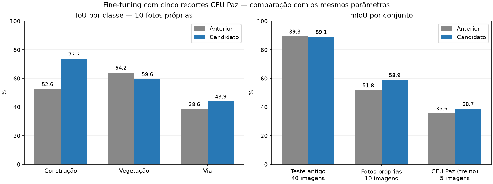

# Fine-tuning com cinco recortes CEU Paz — 02/11/2026

O usuário confirmou os cinco primeiros recortes CEU Paz como completamente
rotulados e orientou excluir os sete restantes, substituindo o plano inicial
de aguardar os 12. Essa seleção é registrada no manifesto; os campos de revisão
dos JSON originais foram preservados.

## Dataset separado

Foi criado `runs/dataset_ceu_paz_5`, contendo:

- Treino: 280 imagens antigas e cinco CEU Paz, total de **285**.
- Validação: as mesmas **80** imagens do split antigo.
- Teste: as mesmas **40** imagens do split antigo.
- Fotos próprias: dez imagens mantidas fora do treinamento.

Os cinco recortes são `DJI_0005`, `DJI_0017`, `DJI_0022`, `DJI_0032` e `DJI_0043`,
em ordem alfabética dos nomes completos. Seus 119 polígonos foram exportados
dos JSON para YOLO-seg: 65 construções, 44 vegetações e dez vias. Os recortes
ficam juntos em treino devido à sobreposição espacial do levantamento. O sexto
recorte também possui JSON, mas foi excluído conforme a seleção do usuário.

Os 400 rótulos antigos, ausentes no repositório, foram reconstruídos diretamente
das máscaras no ZIP original em `Downloads`. O conversor atual preserva buracos,
usa área mínima relativa de 0,0005 e simplificação 0,002. As máscaras foram
redimensionadas com nearest-neighbor para as dimensões das imagens existentes.
Os splits foram preservados pelo nome dos arquivos; não houve nova divisão.

Há **405 pares válidos e 6434 polígonos** no dataset resultante, sem imagens
binariamente duplicadas. A preparação validou classes, coordenadas finitas em
0–1, quantidade de pontos e presença dos pares. Os hashes das imagens copiadas,
dos rótulos novos e dos arquivos de origem ficam em
`runs/dataset_ceu_paz_5/manifesto.json`. As imagens, anotações e pesos originais
não foram sobrescritos.

## Configuração

O treino usa os pesos `runs/mvp_drone/weights/best.pt` como inicialização, com
Ultralytics 8.4.190, PyTorch 2.14.1+cu130 e a RTX 4050. Não é um resume do estado
de otimização: os pesos anteriores foram finalizados sem otimizador.

A configuração está em `configs/finetune_ceu_paz_5.yaml`: 20 épocas no máximo,
patience 5, batch 8, entrada 640, dois workers, AMP, AdamW e learning rate 1e-4.
O aquecimento dura uma época e o bias também começa em 1e-4, evitando o valor
padrão 0,1 durante a adaptação de pesos já treinados. As outras augmentações
permanecem nas opções nativas do trainer.

O script resolve `model`, `data` e `project` a partir da raiz do projeto e grava
`execucao.json` e `gpu.csv` na pasta real retornada pelo trainer. Os novos pesos
ficam em uma execução separada; o caminho padrão usado pelo bot não é alterado.

## Reprodução

Na raiz do projeto, com acesso à GPU:

```bash
# Cria uma pasta nova; recusa sobrescrever uma saída existente.
PYTHONDONTWRITEBYTECODE=1 .venv/bin/python scripts/preparar_finetuning_ceu_paz.py

# Três épocas com todos os dados, incluindo os cinco recortes.
PYTHONDONTWRITEBYTECODE=1 .venv/bin/python scripts/treinar_ceu_paz.py --smoke

# Fine-tuning principal, limitado a 20 épocas e sujeito a early stopping.
PYTHONDONTWRITEBYTECODE=1 .venv/bin/python scripts/treinar_ceu_paz.py
```

Se o dataset já estiver preparado, pular a primeira linha. Para reconstruir
uma outra cópia, fornecer `--saida` apontando a uma pasta nova. O trainer mantém
`exist_ok=False`, criando outra pasta se o nome da execução já existir.

Para avaliar um candidato:

```bash
PYTHONDONTWRITEBYTECODE=1 .venv/bin/python scripts/avaliar_ceu_paz.py \
  --pesos runs/ceu_paz_5_finetune/weights/best.pt \
  --saida runs/ceu_paz_5_avaliacao_repro.json
```

O avaliador usa os mesmos parâmetros e funções semânticas de `src.evaluate`,
confiança 0,25 e resolução de entrada 640. Compara o teste antigo, as fotos
próprias e o ajuste nos cinco recortes de treino. O último conjunto não é teste
independente e não demonstra generalização. As fotos próprias são diagnóstico
de um voo já consultado; um voo novo independente continua sendo desejável.

## Validação antes do treino principal

A validação dos pesos originais nos rótulos reconstruídos obteve mAP50–95 de
caixas de 46,348% e de máscaras de **36,997%**. O resultado histórico das máscaras
era 36,979%; a comparação dos novos candidatos usa a referência reconstruída.

Um primeiro smoke test terminou três épocas em **25,18 s** de tempo registrado
no CSV, cerca de **33,95 imagens/s** incluindo validação. AMP passou na checagem
e não houve imagens corrompidas ou erro de memória. A loss de segmentação caiu
de 1,662 para 1,484. A taxa inicial padrão do bias, porém, provocou uma queda
transitória na validação, motivando sua redução antes de repetir o teste.

Esse primeiro teste ficou em `runs/segment/runs/ceu_paz_5_smoke`, pois um project
relativo foi expandido pelo Ultralytics. O iniciador passou a resolver o caminho
absoluto, mantendo a saída principal diretamente em `runs/`.

O avaliador recusa sobrescrever um resultado existente; escolher outro nome de
saída para novas avaliações.

## Execução concluída

O smoke test ajustado completou três épocas em **21,26 s** de tempo registrado
no CSV, ou **26,81 s** incluindo setup e avaliação final. A loss de segmentação
de treino passou de 1,503 para 1,427 e a de validação de 2,323 para 2,315.
O checkpoint selecionado teve mAP50–95 de máscaras de 37,142%, frente a 36,997%
da referência. Não houve NaN/Inf, erro de memória ou imagens corrompidas.

O fine-tuning principal foi limitado a 20 épocas, mas o early stopping encerrou
após **seis**, com melhor fitness conjunta na **primeira época**. A loss de
segmentação caiu de 1,586 para 1,502, enquanto o critério de validação não superou
o máximo inicial nas cinco épocas seguintes. O teto de épocas não foi forçado.

- Tempo acumulado no CSV: **52,33 s**; aproximadamente **32,68 imagens/s efetivas**,
  incluindo validação e operações entre épocas.
- Tempo da chamada de treinamento, incluindo setup e avaliação final: **63,49 s**.
- AMP efetivamente habilitado, batch 8, acumulação nominal 8 e 36 lotes por época.
- Utilização global da GPU: média amostrada **74,66%**, máxima **100%**, 59 amostras.
- Memória global da GPU: pico amostrado **4398 MiB**, incluindo outros processos.

As amostras de GPU incluem validação e intervalos entre fases; não medem tempo de
espera do dataloader isoladamente. Não foi necessário mudar cache, batch ou
workers após o teste válido. A velocidade histórica de 211,655 s/época não deve
ser interpretada como benchmark controlado de hardware contra esta execução:
o regime de fine-tuning e o dataset também mudaram.

Pesos novos: **`runs/ceu_paz_5_finetune/weights/best.pt`**. O modelo padrão em
`src/config.py` continua apontando para os pesos anteriores; nenhum checkpoint
antigo foi substituído. O SHA-256 de ambos os modelos está no JSON dos resultados.

## Comparação final dos pesos

Os dois modelos foram avaliados em GPU com os mesmos arquivos, resolução 640,
confiança 0,25, máscaras nativas e resolução de sobreposição por confiança.

| Conjunto | Imagens | mIoU anterior | mIoU candidato | Diferença |
| --- | ---: | ---: | ---: | ---: |
| Teste antigo, Semantic Drone | 40 | 89,31% | 89,05% | −0,26 p.p. |
| Fotos próprias, fora do treino | 10 | **51,76%** | **58,93%** | **+7,17 p.p.** |
| CEU Paz, conjunto de treino | 5 | 35,58% | 38,66% | +3,08 p.p. |

Nas fotos próprias, o mDice passou de **67,57% para 73,43%**. O baseline em GPU
tem pequenas diferenças em relação ao relatório anterior em CPU; os valores
acima comparam duas execuções novas com a mesma configuração.

| Classe nas fotos próprias | IoU anterior | IoU candidato | Diferença |
| --- | ---: | ---: | ---: |
| Construção | 52,55% | **73,33%** | +20,77 p.p. |
| Vegetação | **64,16%** | 59,57% | −4,59 p.p. |
| Via | 38,56% | **43,89%** | +5,33 p.p. |



O candidato melhorou a média nas fotos próprias, principalmente construção,
com regressão em vegetação e pequena perda no teste antigo. O resultado justifica
avaliar esse candidato para o cenário de drone, mas não demonstra ganho uniforme
entre classes nem generalização para outros voos. Nenhum hiperparâmetro adicional
foi ajustado usando os resultados finais das dez fotos próprias.

As métricas CEU Paz medem ajuste aos próprios exemplos de treino; não são usadas
como evidência de generalização. O checkpoint foi escolhido pelo critério nativo
de validação do Ultralytics, sem selecionar pesos a partir do teste final.

Para experimentar o candidato em uma imagem:

```bash
.venv/bin/python -m src.predict CAMINHO_DA_FOTO \
  --pesos runs/ceu_paz_5_finetune/weights/best.pt
```

O [resumo em JSON](finetuning_ceu_paz_5_resultados.json) registra configuração,
curvas de seis épocas, métricas por classe, hashes dos pesos e monitoramento.
Os detalhes por imagem ficam em `runs/ceu_paz_5_avaliacao_baseline.json` e
`runs/ceu_paz_5_avaliacao_candidato.json`. `results.csv`, `execucao.json`,
`gpu.csv`, gráficos e pesos ficam na pasta da execução principal.

Ao final, foram novamente conferidos os hashes dos arquivos originais e dos
405 pares do dataset preparado. Os dados incompletos permaneceram excluídos e
nenhuma foto própria entrou no treino.
